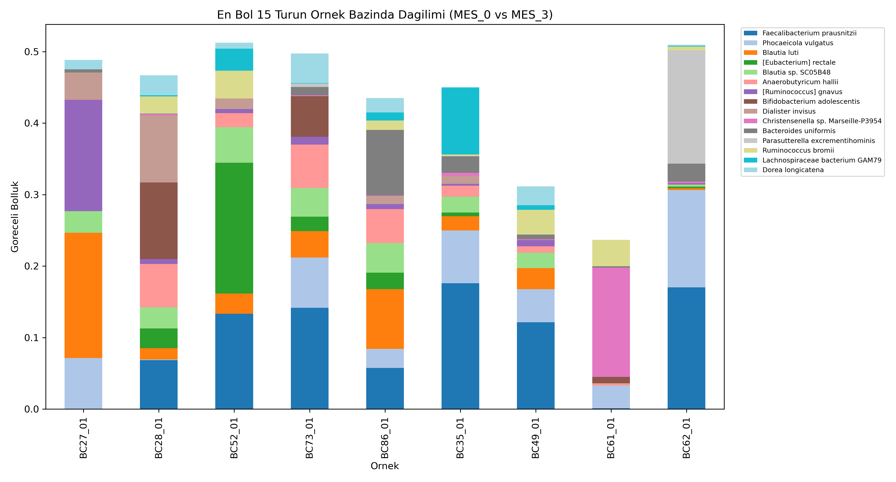
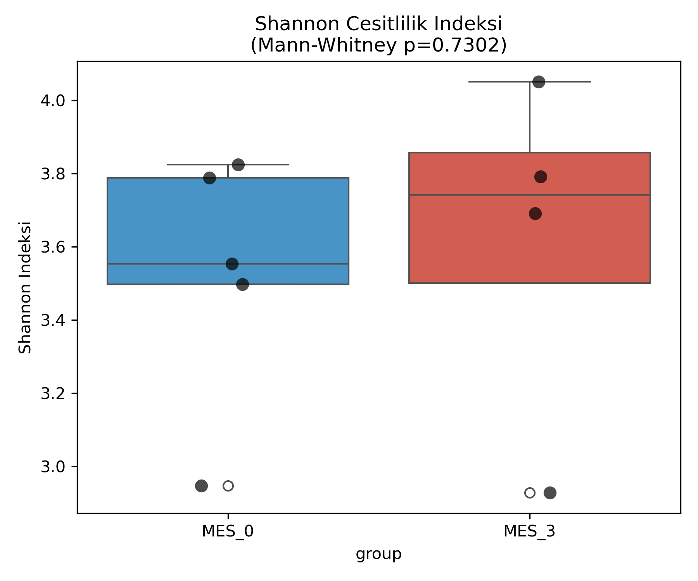

# Ulseratif Kolit (UC) Siddetine Gore Bagirsak Mikrobiyomu Analizi

## Amac
Bu proje, tam uzunlukta (full-length) Nanopore 16S rRNA dizileme verisini
kullanarak ulseratif kolit hastalarinda hastalik siddetinin (MES0: hafif/
remisyon vs MES3: siddetli aktif UC) bagirsak mikrobiyom kompozisyonu ve
cesitliligi ile iliskisini incelemeyi amaclamaktadir.

## Veri Kaynagi
- Kaynak: Zenodo (DOI uzerinden halka acik), "Microbial selenoproteins in
  ulcerative colitis" calismasi, Ocak 2026
- 9 disk ornegi: 5 MES0 (hafif/remisyon), 4 MES3 (siddetli aktif UC)
- Dizileme teknolojisi: Oxford Nanopore, tam uzunlukta (~1500bp) 16S rRNA geni
- Meta veri: Metadata_MES0_MES3.xlsx (ayni Zenodo kaydinda saglanmistir)

## Yontem
1. Ham FASTQ verisi (Nanopore, barkod basina tek dosya) Zenodo'dan indirildi
2. NanoPlot ile ham okumalarin kalite/uzunluk dagilimi incelendi
3. Chopper ile kalite (Q>=10) ve uzunluk (1200-1650bp) filtrelemesi yapildi
   - Bu aralik, tam uzunlukta 16S geninin (~1500bp) beklenen sinirlarina
     gore secildi; cok kisa/cok uzun okumalar (sekanslama artefaktlari)
     elendi
4. Emu (Nanopore tam uzunlukta 16S'e ozel bir tur-duzeyi bolluk kestirici)
   ile her okuma, minimap2 tabanli hizalama ve Expectation-Maximization
   algoritmasiyla tur duzeyinde siniflandirildi
5. 9 ornegin sonuclari (rel-abundance.tsv dosyalari) Python/pandas ile
   tek bir tur x ornek tablosunda birlestirildi
6. Shannon cesitlilik indeksi her ornek icin hesaplandi, MES0 vs MES3
   karsilastirmasi Mann-Whitney U testi ile yapildi
7. En bol 15 turun ornek bazinda goreceli bolluk dagilimi gorsellestirildi

## Kullanilan Araclar
NanoPlot, Chopper, Emu (minimap2 tabanli), Python (pandas, numpy, scipy,
matplotlib, seaborn)

## Onemli Metodolojik Not
Bu veri seti tam uzunlukta Nanopore 16S verisi oldugu icin, kisa-okuma
(Illumina) verilerinde standart olan DADA2 denoising yontemi KULLANILMAMISTIR.
Ham veri incelendikten sonra (okuma uzunlugu ~1389bp olculdu), Nanopore'a
ozel gelistirilmis Emu araci tercih edilmistir. Bu, pipeline'in veri tipine
gore bilincli olarak uyarlanmasina bir ornektir.

## Sonuclar

### Kalite Filtreleme
9 ornegin tamami icin okuma kaybi dusuk duzeyde kalmistir (ortalama %3-4),
bu da ham verinin zaten yuksek kalitede oldugunu gostermektedir. Toplamda
~485.000 kaliteli, tam uzunlukta 16S okumasi analiz edilmistir.

### Tur Siniflandirmasi (Emu)
Ornek basina ortalama eslesme orani son derece yuksek cikmistir (cogu
ornekte %99.6-100 okuma siniflandirilabilmistir), bu da Emu + tam
uzunlukta 16S yaklasiminin guvenilirligini desteklemektedir.

### Alfa Cesitlilik (Shannon Indeksi)
| Ornek | Grup | Shannon |
|-------|------|---------|
| BC27_01 | MES0 | 2.95 |
| BC28_01 | MES0 | 3.55 |
| BC52_01 | MES0 | 3.50 |
| BC73_01 | MES0 | 3.79 |
| BC86_01 | MES0 | 3.82 |
| BC35_01 | MES3 | 3.69 |
| BC49_01 | MES3 | 3.79 |
| BC61_01 | MES3 | 4.05 |
| BC62_01 | MES3 | 2.93 |

Mann-Whitney U testi: p=0.73 -> MES0 ve MES3 gruplari arasinda genel
cesitlilik duzeyinde istatistiksel olarak anlamli bir fark bulunamamistir.

### Tur Kompozisyonu Gozlemi
Grup genelinde anlamli bir fark olmasa da, birey duzeyinde dikkat cekici
bir gozlem yapilmistir: BC61_01 (MES3, en dusuk cesitlilige sahip ornek)
klasik UC-iliskili disbiyoz paterni gostermektedir - faydali, butirat
ureten Faecalibacterium prausnitzii turunun neredeyse yok denecek kadar
az oldugu, bunun yerine Christensenella turunun baskin oldugu gorulmustur.
Ancak bu patern MES3 grubunun geneli icin gecerli degildir; BC35_01 ve
BC62_01 gibi diger siddetli UC ornekleri, MES0 ornekleriyle benzer
duzeyde F. prausnitzii icermektedir.

## Sinirliliklar
- Orneklem buyuklugu kucuktur (5 MES0, 4 MES3); bu, istatistiksel gucu
  sinirlamakta ve grup-duzeyinde anlamli farklari tespit etmeyi
  zorlastirmaktadir
- Her gruptaki grup-ici varyasyon (orn. MES3 icinde BC61 ile BC62
  arasindaki buyuk fark), gruplar-arasi farktan daha baskin cikmistir
- Beta cesitlilik (PCoA) ve formal diferansiyel bolluk testi (orn.
  ANCOM-BC) bu analizde yapilmamistir; gelecek calismalarda eklenebilir
- Emu'nun varsayilan veritabani 2020'den beri guncellenmemistir; cok
  yeni tanimlanmis turler veritabaninda eksik olabilir
- Bu bir portfoy/ogrenme projesidir, klinik tani veya tedavi karari
  icin kullanilamaz

## Proje Yapisi
mikrobiyom-analizi-uc/
- data/      : Ham ve filtrelenmis FASTQ dosyalari, metadata
- ref/       : Emu referans veritabani
- results/   : Emu siniflandirma ciktilari, birlesmis bolluk tablosu
- scripts/   : Analiz script'i
- figures/   : Shannon cesitlilik ve tur dagilim grafikleri
- README.md

## Sonraki Adim
Yol haritasindaki bir sonraki proje olan "ilac hedefi / docking" projesine
gecilecektir; onceki projede (EGFR protein 3D yapi tahmini) uretilen
model, bu projede potansiyel inhibitorlerle test edilecektir.

## Yazar
Atakan Aslan - Molekuler Biyoloji ve Genetik, Sivas Cumhuriyet Universitesi
